

# 📖 قرآن ريدر لايت — ويندوز

  🌐 اللغة: <strong>العربية</strong> · <a href="README.md" dir="ltr">English</a>

  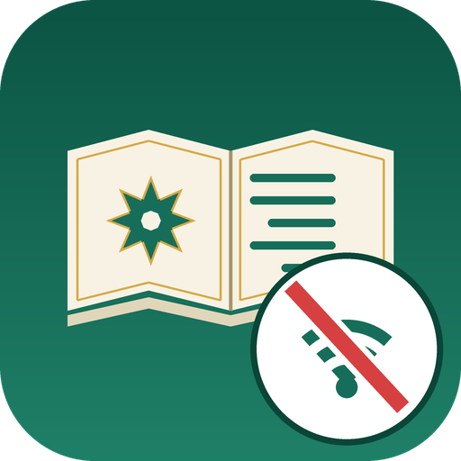

**قرآن ريدر لايت** تطبيق خفيف لقراءة القرآن الكريم على نظام Windows، ويعمل دون اتصال بالإنترنت. يوفّر النص العربي الكامل للقرآن فقط، دون ترجمات أو تفاسير.

> 🪟 يخص هذا المستودع إصدار Windows وحده.

مصدر نص القرآن: [Tanzil](https://tanzil.net) — ترخيص CC BY 3.0.

---

## ⬇️ التنزيل

- 💽 [تحميل نسخة التثبيت (Setup 1.0.7)](https://github.com/mediadesign853-cpu/Quran-Lite/releases/download/v1.0.7/Quran-Reader-Lite-Setup-1.0.7.exe)
- ⚡ [تحميل النسخة المحمولة (Portable 1.0.7)](https://github.com/mediadesign853-cpu/Quran-Lite/releases/download/v1.0.7/Quran-Reader-Lite-Portable-1.0.7.exe)

يمكنك أيضاً زيارة [صفحة الإصدارات الرسمية](https://github.com/mediadesign853-cpu/Quran-Lite/releases/latest).

---

## 📸 لقطات الشاشة

انقر على أي صورة لعرضها بحجمها الكامل.

  <a href="docs/screenshots/Screenshot-1.png">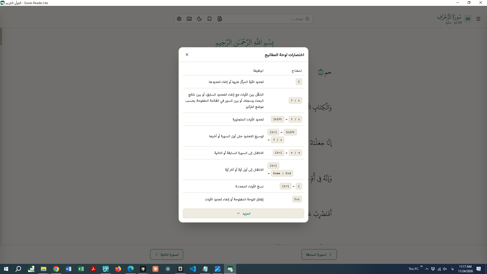</a>
  <a href="docs/screenshots/screenshot-2.png">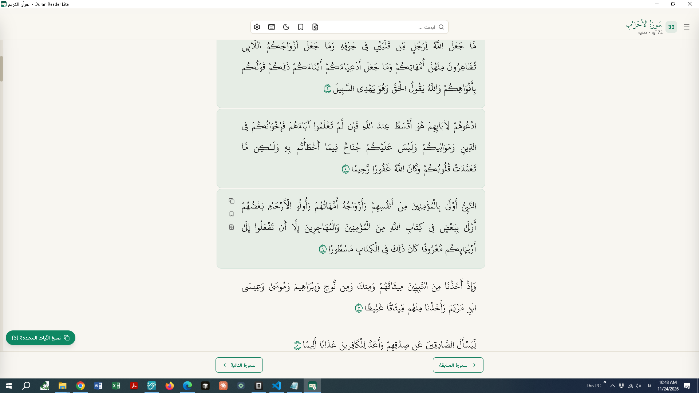</a>

  <a href="docs/screenshots/screenshot-3.png">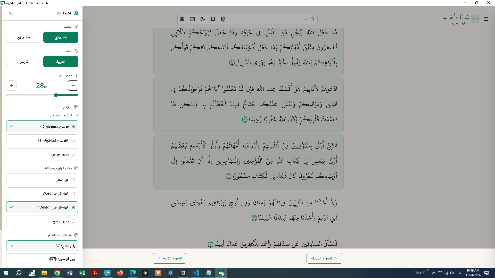</a>
  <a href="docs/screenshots/screenshot-4.png">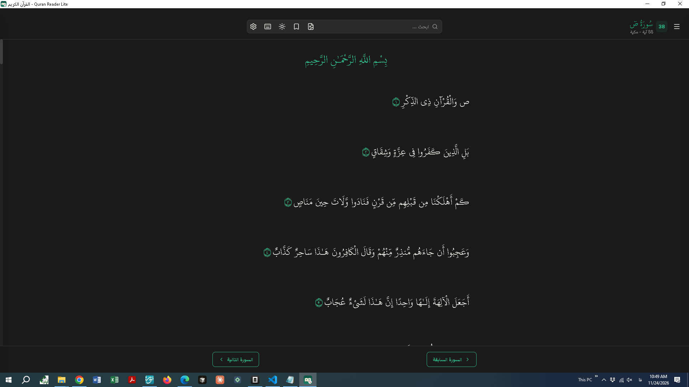</a>

  <a href="docs/screenshots/screenshot-5.png">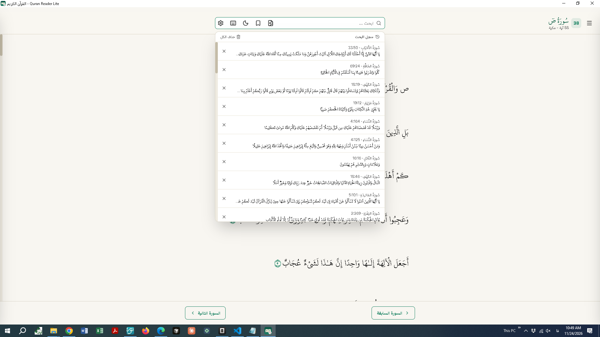</a>
  <a href="docs/screenshots/screenshot-6.png">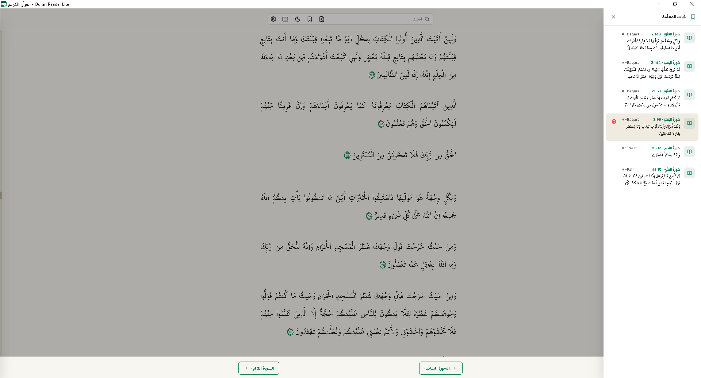</a>

  <a href="docs/screenshots/screenshot-7.png">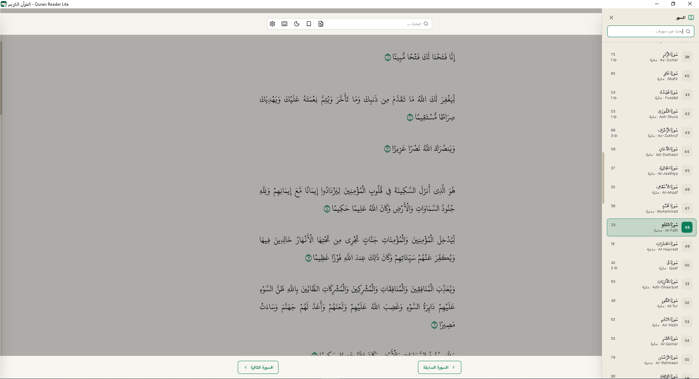</a>
  <a href="docs/screenshots/screenshot-8.png">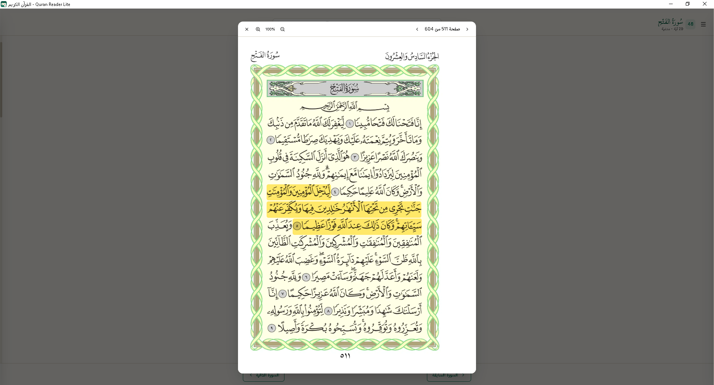</a>

  <a href="docs/screenshots/screenshot-9.png">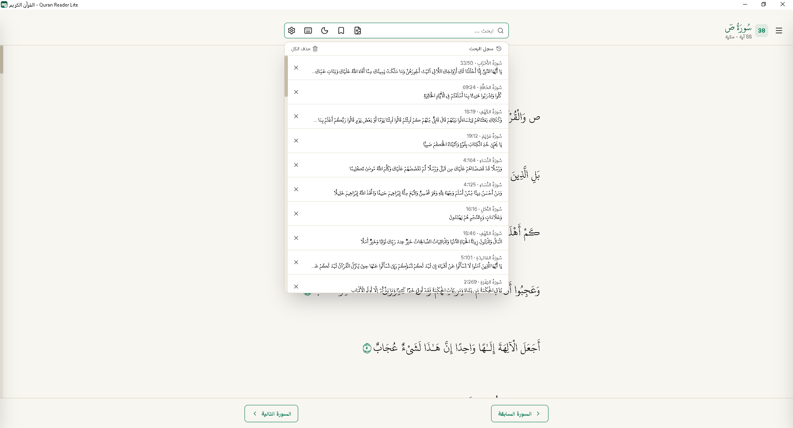</a>

### 🕌 صفحات المصحف

  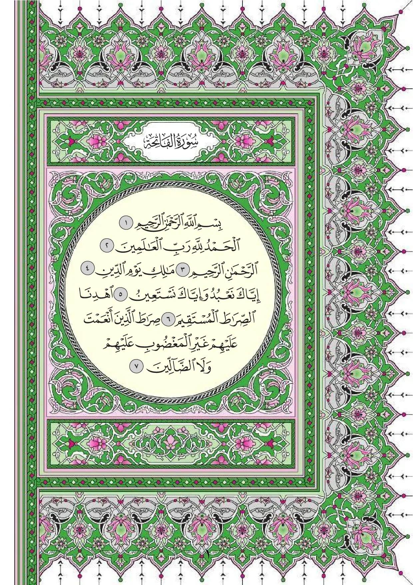

تضم النسخة صفحات المصحف الـ604، ويتم إبراز الآية التي تقرؤها داخل الصفحة، مع إمكانية التكبير والتنقل بين الصفحات.

---

## ✨ ما الذي يوفّره التطبيق؟

- 📖 قراءة السور الـ114 والآيات مع الحفاظ على رسم العثماني.
- 🔎 بحث سريع في أسماء السور ونصوص الآيات.
- 🔖 حفظ العلامات المرجعية وسجل البحث، والعودة تلقائياً إلى آخر موضع قراءة.
- 🎨 واجهة عربية، مع مظهر فاتح أو داكن أو **حسب النظام**، وإمكانية تغيير حجم الخط العربي.
- 📋 نسخ الآيات مع خيارات لرقم الآية والأقواس القرآنية والمرجع.
- 🧾 إدراج هوامش فعلية في Microsoft Word وAdobe InDesign على Windows.
- 🔄 تحديث تلقائي؛ تتحقق النسخة المحمولة من التوقيع الرقمي والبصمة قبل استبدال الملف.
- 🌐 تعمل القراءة والبحث بالكامل دون إنترنت، ولا يلزم الاتصال إلا عند التحديث.

---

## 🧭 دليل الاستخدام

### 📜 قائمة السور

افتح القائمة من زر القائمة أعلى الشاشة، أو اضغط Alt + S. اختر السورة بالنقر عليها، وابحث باسمها أو برقمها في مربع البحث.

### 🔎 البحث عن آية

اضغط Ctrl + F للانتقال إلى مربع البحث. اكتب كلمة أو رقم آية، ثم اختر النتيجة للقفز إلى موضعها. يمكن التنقل بين النتائج بأسهم لوحة المفاتيح.

### 🔖 العلامات المرجعية

احفظ الآية الحالية بضغط B، وافتح لوحة العلامات بضغط Alt + B. تُمسح العلامة بنفس زر الحفظ، وتُغلق اللوحة بضغط Esc.

### 📋 نسخ الآيات

اختر آية أو عدة آيات متتالية، ثم اضغط Ctrl + C أو زر النسخ. من الإعدادات يمكنك تحديد شكل رقم الآية، ونوع الأقواس، وموضع المرجع، وحذف رقم الآية الأخيرة.

### 🕌 صفحات المصحف

اضغط M لعرض الصفحة التي تحتوي الآية الحالية. في عارض الصفحات يمكنك التكبير وتصفح الصفحات بالأسهم، ثم الإغلاق بضغط Esc.

### 🎨 المظهر

من الإعدادات اختر «فاتح» أو «داكن» أو «حسب النظام»؛ فالخيار الأخير يتبع إعداد المظهر في نظام التشغيل تلقائياً. يمكن أيضاً تبديل المظهر بضغط Alt + T.

### 🔄 التحديث التلقائي

يتحقق التطبيق من وجود إصدار جديد بعد تشغيله، ثم بصورة دورية، ويطلب موافقتك قبل التحميل. تحتاج النسخة المحمولة إلى إذن كتابة في المجلد الذي يحتوي ملف EXE. احتفظ بمجلد Quran Reader Lite Data بجانبه. إذا تعذّر التحديث فتبقى النسخة الحالية كما هي.

---

## ⌨️ الاختصارات

| الاختصار | الوظيفة |
|:---:|:---|
| S | تحديد الآية أو إلغاء تحديدها |
| ↑ / ↓ | التنقل بين الآيات أو النتائج أو السور |
| Shift + ↑ / ↓ | تحديد الآيات المجاورة |
| Ctrl + Shift + ↑ / ↓ | توسيع التحديد |
| Ctrl + ← / → | السورة السابقة أو التالية |
| Ctrl + Home / End | أول آية أو آخر آية |
| Ctrl + C | نسخ الآيات المحددة |
| Esc | إغلاق اللوحة أو مسح التحديد |
| Ctrl + F | التركيز على مربع البحث |
| Alt + S | فتح قائمة السور أو إغلاقها |
| Alt + B | فتح العلامات أو إغلاقها |
| Ctrl + , | فتح الإعدادات أو إغلاقها |
| Alt + T | تبديل المظهر |
| Alt + H | عرض مساعدة الاختصارات |
| B | إضافة الآية إلى العلامات أو حذفها |
| M | فتح صفحة المصحف للآية الحالية |
| ← / → | تصفح صفحات المصحف |

---

## ⚠️ ملاحظة الأمان

التوقيع الرقمي وفحص البصمة يحميان **عملية تحديث النسخة المحمولة**، وهما ليسا شهادة ناشر Windows Authenticode. لذلك قد يعرض SmartScreen تحذير «ناشر غير معروف». نزّل التطبيق من [صفحة الإصدارات الرسمية](https://github.com/mediadesign853-cpu/Quran-Lite/releases/latest) فقط.

