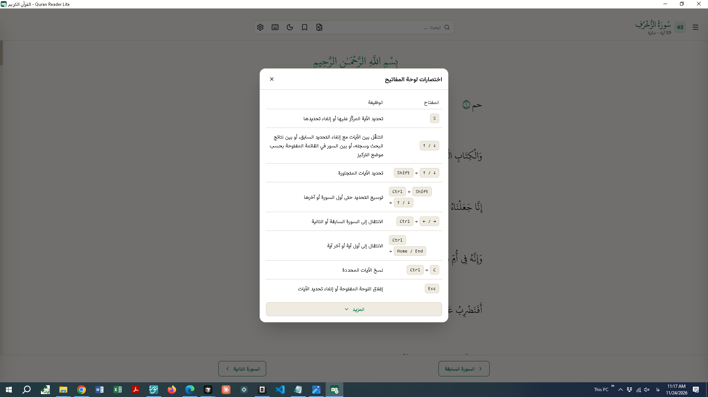
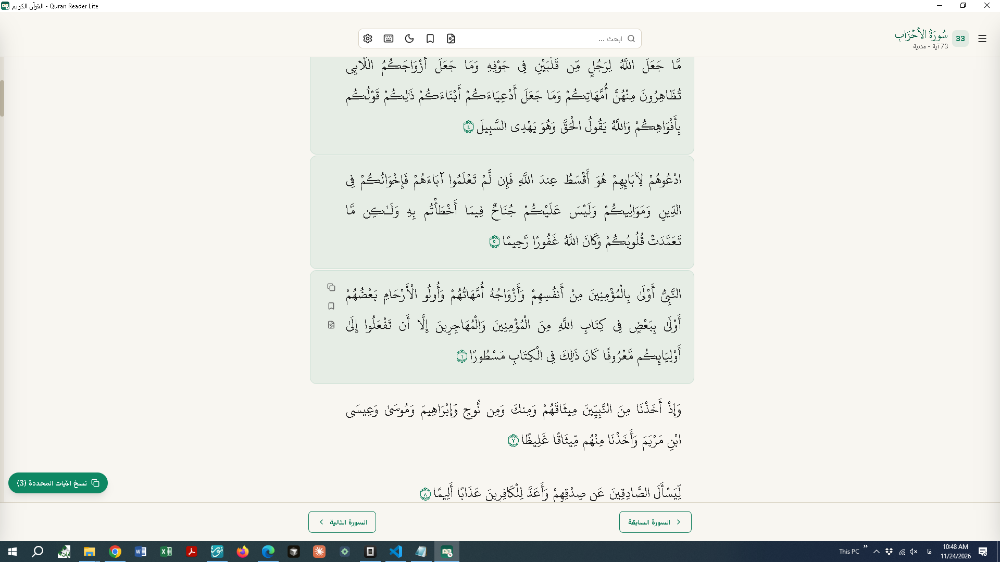
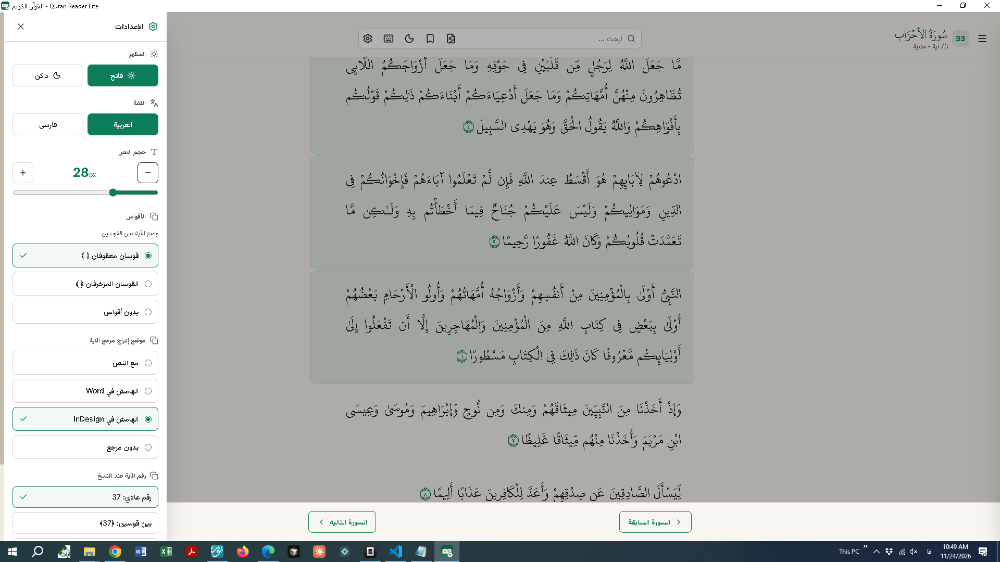
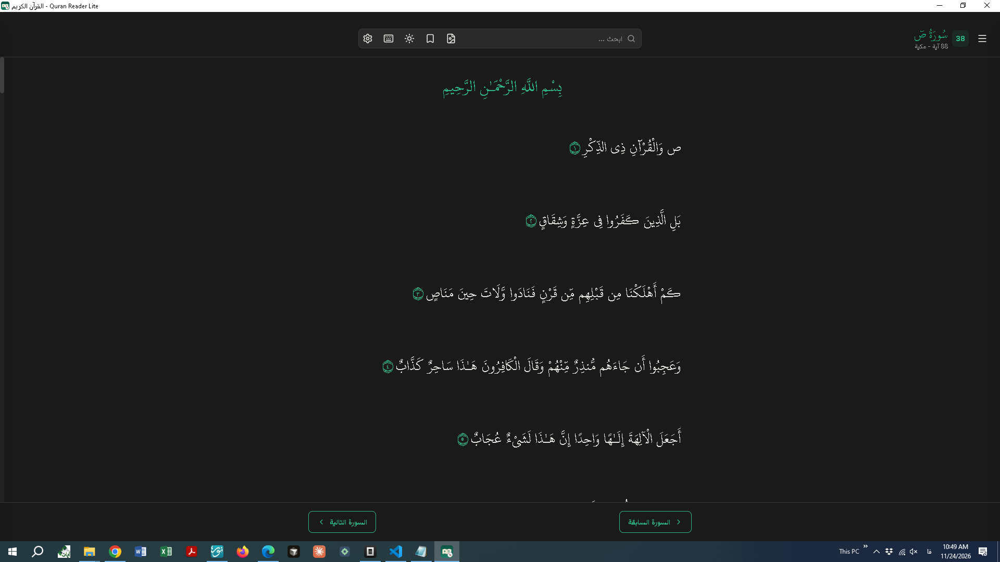
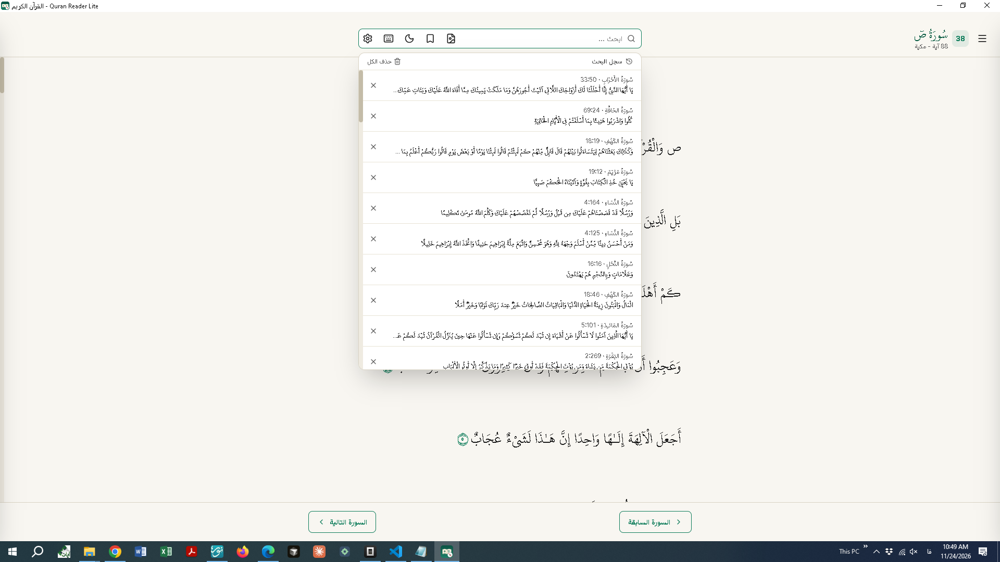
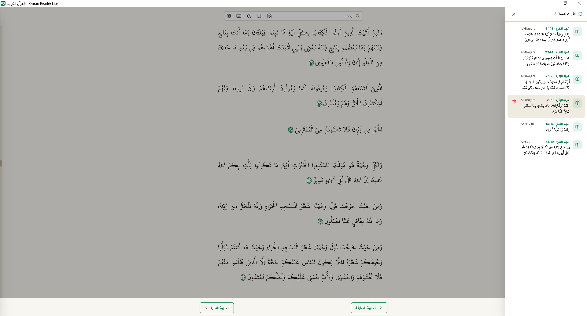
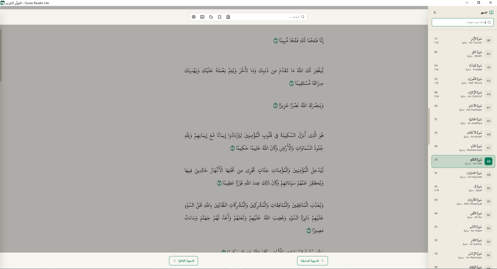
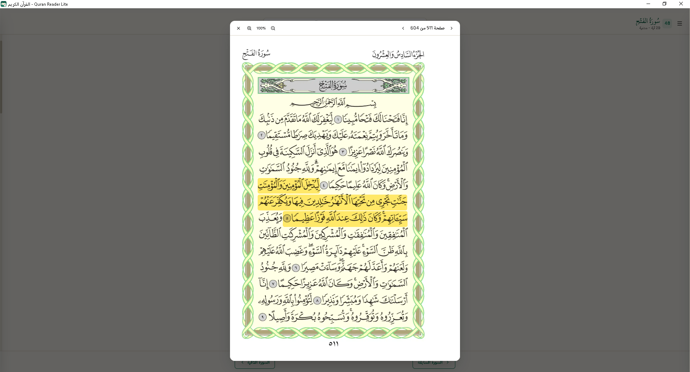
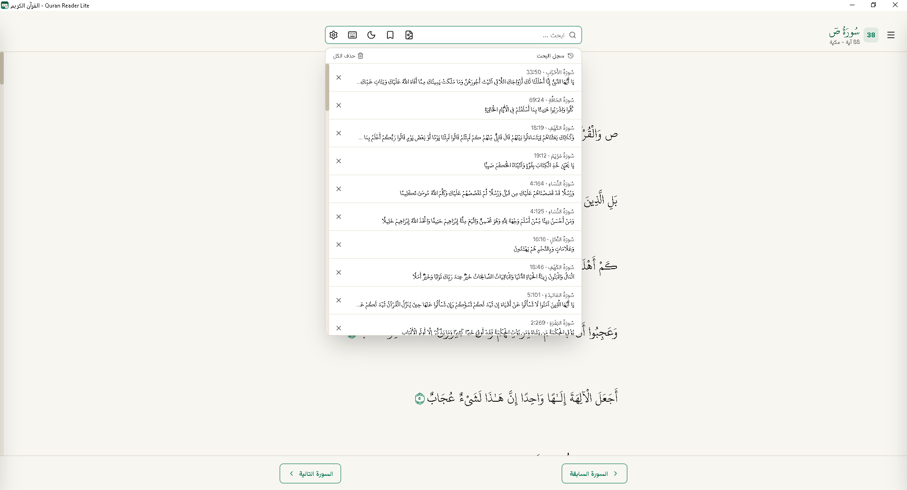

# 📖 Quran Reader Lite — Windows

<p align="center">
  
</p>

<p align="center">
  🌐 Language: <strong>English</strong> · <a href="README.ar.md">العربية</a>
</p>

**Quran Reader Lite** is a lightweight, offline-first Quran reader for **Windows**. It ships the complete Arabic Quran text and deliberately leaves out translations and tafsir, so it starts quickly and needs no network connection for reading.

> 🪟 This repository contains the **Windows** edition only.

Quran text source: [Tanzil](https://tanzil.net) — CC BY 3.0.

---

## ⬇️ Download

Download directly from the links below, or visit the [Releases page](https://github.com/mediadesign853-cpu/Quran-Lite/releases/latest).

| 🪟 Latest release (v1.0.8) | File |
|:---:|:---:|
| 💽 Installer (NSIS) | [📥 Quran Reader Lite Setup 1.0.8.exe](https://github.com/mediadesign853-cpu/Quran-Lite/releases/download/v1.0.8/Quran-Reader-Lite-Setup-1.0.8.exe) |
| ⚡ Portable | [📥 Quran Reader Lite Portable 1.0.8.exe](https://github.com/mediadesign853-cpu/Quran-Lite/releases/download/v1.0.8/Quran-Reader-Lite-Portable-1.0.8.exe) |

The **Portable** build runs without installation. Keep the `Quran Reader Lite Data` folder next to the EXE: it stores settings, bookmarks, and history, and it must stay writable so automatic updates can replace the EXE.

> ℹ️ Portable builds 1.0.0–1.0.3 cannot auto-update to this release: their signed URL check expects the old repository casing. Download 1.0.8 manually from the link above. Builds 1.0.4 and newer continue to update automatically.

---

## 📸 Screenshots

Click any image to open it at full size.

<p align="center">
  <a href="docs/screenshots/Screenshot-1.png"></a>
  <a href="docs/screenshots/screenshot-2.png"></a>
</p>

<p align="center">
  <a href="docs/screenshots/screenshot-3.png"></a>
  <a href="docs/screenshots/screenshot-4.png"></a>
</p>

<p align="center">
  <a href="docs/screenshots/screenshot-5.png"></a>
  <a href="docs/screenshots/screenshot-6.png"></a>
</p>

<p align="center">
  <a href="docs/screenshots/screenshot-7.png"></a>
  <a href="docs/screenshots/screenshot-8.png"></a>
</p>

<p align="center">
  <a href="docs/screenshots/screenshot-9.png"></a>
</p>

### 🕌 Mushaf page images

<p align="center">
  
</p>

All **604 pages** are bundled with the application. The ayah being read is highlighted on its page, and the page viewer supports zoom and previous/next navigation.

---

## ✨ Features

- 📖 Read all 114 surahs with their ayahs and the Uthmani script preserved.
- 🔎 Instant search across surah names and ayah text.
- 🔖 Bookmarks, search history, and automatic resume from the last reading position.
- 🎨 Arabic interface, with light, dark, and **follow the operating system** theme options, plus an adjustable Arabic font size.
- 📋 Copy ayahs with configurable numbers, Quranic brackets, and references.
- 🧾 Insert native footnotes into Microsoft Word or Adobe InDesign on Windows.
- 🖼️ Browse the 604 bundled Mushaf page images.
- 🔄 Automatic updates: `electron-updater` for the installer, and a signed, SHA-512-verified updater for the Portable build.
- 🌐 Reading and searching work fully offline; an internet connection is only needed for updates.

---

## 🛠️ Setup and build (developers)

### Requirements

- **Node.js 22.13+** and **npm 10+**
- **Python 3** for the Quran text regression tests
- Windows for building the Windows packages

Install and verify the project:

```powershell
npm ci
npm run check
```

`npm run check` runs the data verification, Quran text and reference tests, Electron security tests, TypeScript type checking, ESLint, and the web build.

Build both Windows x64 packages:

```powershell
npm run dist:win
```

The files are written to `release/`:

- `Quran Reader Lite Setup <version>.exe`
- `Quran Reader Lite Portable <version>.exe`

If the lockfile needs to be regenerated first, run `npm run refresh:dependencies` once; commit the resulting `package-lock.json` before using `npm ci` in CI.

### 🔐 Portable update keys

| Command | Purpose |
| --- | --- |
| `npm run generate:portable-keys` | Create a new Ed25519 key pair. Run once when setting up updates, **not** for every release. |
| `npm run verify:portable-key` | Check that the public key is present and valid. |
| `npm run create:portable-manifest` | Hash the Portable EXE and create the signed `latest-portable.json`. |

Key files:

- `electron/portable-update-public.pem` — public key; keep it committed, because installed clients trust this exact key.
- `.secrets/portable-update-private.pem` — private key; never commit or share it. Store its contents as the GitHub Actions secret `PORTABLE_UPDATE_PRIVATE_KEY`.

The manifest script signs the **GitHub asset name** (`Quran-Reader-Lite-Portable-<version>.exe`), which differs from the local build file name because electron-builder replaces spaces with hyphens when uploading assets. `PORTABLE_UPDATE_REPO` can override the repository path in the signed download URL when older clients expect different casing. Never generate a new key pair for an existing release chain: old installations would reject the new signature.

### 🤖 Releasing with GitHub Actions

The workflow `.github/workflows/release-windows.yml` runs **only when a tag starting with `v` is pushed**. Existing tags are never removed, so the update chain stays intact.

1. Set the new version in `package.json` and `package-lock.json` (for example `1.0.8`).
2. Regenerate the lockfile if dependencies changed, then run `npm run check`.
3. Commit, push `main`, and push a matching tag:

```powershell
git add package.json package-lock.json
git commit -m "Release v1.0.8"
git push origin main
git tag v1.0.8
git push origin v1.0.8
```

The runner installs dependencies, runs the checks, builds both packages, creates the signed Portable manifest, uploads the assets, and publishes the release only after the update metadata is present. Required repository secret: `PORTABLE_UPDATE_PRIVATE_KEY`.

### 🔄 Update behaviour

- The packaged app checks for updates about 15 seconds after launch, then every 12 hours, and asks before installing.
- **Installer:** `electron-updater` reads `latest.yml` from the GitHub release.
- **Portable:** the app downloads `latest-portable.json`, verifies its Ed25519 signature, downloads the EXE, and checks its SHA-512 and size before a PowerShell helper replaces the old file. The previous EXE is kept until the new one starts successfully.
- Portable updates need write access to the folder containing the EXE. If anything fails, the existing version is left untouched.
- Older Portable releases used a different repository casing in their download URL; a signed manifest for each release must match the URL expected by that release's clients. The v1.0.4 release carries a corrected legacy manifest, and v1.0.5 and later use the current casing.

---

## ⌨️ Keyboard shortcuts

| Shortcut | Action |
|---|---|
| `S` | Select / deselect the focused ayah |
| `↑ / ↓` | Move between ayahs, results, or surahs |
| `Shift + ↑ / ↓` | Select adjacent ayahs |
| `Ctrl + Shift + ↑ / ↓` | Extend the selection |
| `Ctrl + ← / →` | Previous / next surah |
| `Ctrl + Home / End` | First / last ayah |
| `Ctrl + C` | Copy the selected ayahs |
| `Esc` | Close a panel or clear the selection |
| `Ctrl/Cmd + F` | Focus the search box |
| `Alt + S` | Toggle the surah list |
| `Alt + B` | Toggle bookmarks |
| `Ctrl/Cmd + ,` | Toggle settings |
| `Alt + T` | Toggle the theme |
| `Alt + H` | Open the shortcut help |
| `B` | Bookmark the focused ayah |
| `M` | Open its Mushaf page |
| `← / →` | Turn Mushaf pages in the page viewer |

---

## 🛡️ Security note

The Ed25519 signature and SHA-512 checks protect the **Portable update process**; they are not a Windows Authenticode publisher signature. The EXE files are not Authenticode-signed, so Windows SmartScreen may show an “Unknown publisher” warning. Download only from the [official Releases page](https://github.com/mediadesign853-cpu/Quran-Lite/releases/latest).

Electron permissions are denied by default: clipboard reads, notifications, geolocation, camera, microphone, display capture, USB, and HID are blocked. Only sanitized clipboard writes from the trusted `app://quran` renderer are allowed for the copy feature. Page images are served from the internal `qpage://pages` host.
